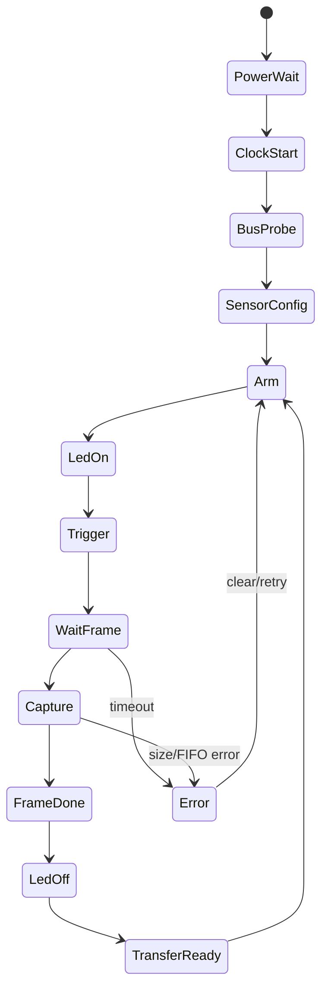

# MT9P031 / AVT 5.0 MP Camera Module FPGA Integration Guide

Prepared for: FPGA / embedded camera-interface development  
Sensor: onsemi MT9P031 1/2.5-inch 5 MP CMOS image sensor  
Module: existing “AVT 5,0 MP Kameraplatine” connected through 30-pin ZIF connector BU111  
Primary source: onsemi MT9P031 datasheet, MT9P031-D, Rev. 12, July 2025  
System source: camera section 5.3 and BU111 schematic excerpt supplied with the project

## Revision note — connector and datasheet bring-up review, 2026-10-09

Reviewed sources: the supplied original BU133 image (`image(9).png`), new J9 image (`image(8).png`), BU111 camera connector image (`image(10).png`), and this guide. Contact assignments are transcribed from the three connector excerpts. GPIO suffixes and connector contacts are not FPGA package sites. Section 4.1 now documents the verified contact-to-net correspondence; Section 4.2 includes all 72 contacts. The numeric camera package-site assignments are now established from the supplied LPF [F1] and restored in Section 4.1; GPIO_TOP comments agree with the connector mapping. The BU111 mapping is now checked against the supplied camera connector excerpt. Contacts 10, 12, 24, 27 and 29 were corrected from GND to NC; only contacts 2 and 4 connect to the shown ground bus.

Scope: connector mapping plus sensor bring-up review against the supplied MT9P031/D Rev. 12. Supply/timing tables and working examples are checked against that PDF. Section 9 explicitly separates PDF fields from supplemental upstream-driver identifiers and missing register-reference details. Section 15 replaces flawed pseudocode with a capture specification. Settings are calculated recommendations and remain untested on hardware; configured FPGA sites are established from the LPF, while the FPGA part/package match, electrical/timing validity and camera-board internal circuitry remain unresolved.

## 1. Purpose of this document

This document gives the FPGA engineer enough information to start implementing the camera interface for the existing AVT 5.0 MP camera board using the onsemi MT9P031 sensor.

The existing system uses the camera to illuminate and capture the serial-number area of a heater tube. The camera board is mounted so that the sensor center is aligned with the center of the positioned tube. The required transferred image is a grayscale image of 1024 x 400 pixels. The optical field is approximately 50 mm x 10 mm, giving approximately:

| Direction | Field | Pixels | Resolution |
|---|---:|---:|---:|
| Horizontal | 50 mm | 1024 px | 0.0488 mm/px |
| Vertical | 10 mm | 400 px | 0.0250 mm/px |

The previous project text expects a monochrome production camera, but the supplied PDF describes an RGB Bayer interface; the actual installed sensor suffix must be checked before treating that project expectation as confirmed. Some prototypes may use a color/Bayer sensor. The FPGA should therefore treat the incoming 12-bit pixel stream as raw sensor data and perform a defined grayscale conversion or filtering stage so the output to the Panel-PC is grayscale regardless of sensor optical filter.

## 2. System-level camera function

The camera subsystem consists of:

- AVT 5.0 MP camera PCB with MT9P031 CMOS image sensor.
- M12 lens, 6 mm focal length, AVT0626B-3MP.
- LED illumination for the camera scene, identified in the project text as ST112.
- FPGA-side logic for camera clocking, sensor configuration, image capture, optional filtering/grayscale conversion, LED timing, and transfer to the Panel-PC.

The camera board connects to the main board through BU111, a 30-pin ZIF connector. The supplied schematic note says:

> Achtung! Sensorplatine für 5,0V Versorgung bestücken!

This means the camera board is populated for a 5.0 V module supply. It does not mean the MT9P031 sensor I/O pins are 5 V tolerant. The FPGA I/O voltage level must be verified on the real hardware by checking the camera-board regulators, level shifting, and the FPGA bank voltage.

## 3. Important sensor facts

| Parameter | MT9P031 value / behavior |
|---|---|
| Native active resolution | 2592 x 1944 pixels |
| Physical array | 2752 x 2004 pixels |
| Pixel size | 2.2 µm x 2.2 µm |
| Active image area | approximately 5.70 mm x 4.28 mm |
| Output interface | 12-bit parallel pixel bus plus PIXCLK, FRAME_VALID, LINE_VALID, STROBE |
| Pixel format | one 12-bit pixel per PIXCLK while FRAME_VALID and LINE_VALID are active |
| Configuration interface | two-wire serial interface, I²C-like |
| Max serial clock | 400 kHz |
| Default operation | continuous electronic rolling shutter |
| Snapshot support | electronic rolling shutter and global-reset-release modes |
| Sensor supplies | 1.8 V core, 1.8/2.8 V I/O, 2.8 V analog/PLL |
| Module supply from BU111 | 5 V, converted or handled on camera PCB |

The sensor can output a full 2592 x 1944 frame, but this project only needs 1024 x 400. The FPGA should configure a window/region of interest and capture only the valid 1024 x 400 image area.

## 4. BU111 30-pin connector mapping

The following BU111 pinout is checked against the supplied schematic excerpt titled “Anschluss Kamera Platine 111”, reference BU111, connector label WE 68713014522. Signal crossings with the vertical ground bus use bridge arcs and are not ground connections. Only pins 2 and 4 connect to that ground bus. NC means no connection is shown in this excerpt. Signal directions describe the intended interface; buffering and sensor-side wiring still require the camera-board schematic.

| BU111 pin | Net name | Direction from FPGA point of view | Purpose |
|---:|---|---|---|
| 1 | 5VFPGA | Power output to camera module | 5 V camera-board supply |
| 2 | GND | Power | Ground |
| 3 | NC / not shown connected | — | No connection shown |
| 4 | GND | Power | Ground |
| 5 | KAM_TRIGGER | FPGA output | Sensor/module trigger input |
| 6 | KAM_STROBE | FPGA input, likely from sensor/module | Exposure strobe / illumination timing reference |
| 7 | NC / not shown connected | — | No connection shown |
| 8 | KAM_SDATA | Bidirectional open-drain | Sensor two-wire serial data |
| 9 | KAM_SCLK | FPGA output open-drain or open-drain-compatible | Sensor two-wire serial clock |
| 10 | NC / not shown connected | — | No connection shown |
| 11 | KAM_D00 | FPGA input | Pixel data bit 0 |
| 12 | NC / not shown connected | — | No connection shown |
| 13 | KAM_D01 | FPGA input | Pixel data bit 1 |
| 14 | KAM_D02 | FPGA input | Pixel data bit 2 |
| 15 | KAM_D03 | FPGA input | Pixel data bit 3 |
| 16 | KAM_D04 | FPGA input | Pixel data bit 4 |
| 17 | KAM_D05 | FPGA input | Pixel data bit 5 |
| 18 | KAM_D06 | FPGA input | Pixel data bit 6 |
| 19 | KAM_D07 | FPGA input | Pixel data bit 7 |
| 20 | KAM_D08 | FPGA input | Pixel data bit 8 |
| 21 | KAM_D09 | FPGA input | Pixel data bit 9 |
| 22 | KAM_D10 | FPGA input | Pixel data bit 10 |
| 23 | KAM_D11 | FPGA input | Pixel data bit 11, MSB |
| 24 | NC / not shown connected | — | No connection shown |
| 25 | KAM_FRAME | FPGA input | FRAME_VALID / frame active |
| 26 | KAM_LINE | FPGA input | LINE_VALID / line active |
| 27 | NC / not shown connected | — | No connection shown |
| 28 | KAM_PIXCLK | FPGA input | Pixel clock from sensor/module |
| 29 | NC / not shown connected | — | No connection shown |
| 30 | KAM_MCLK | FPGA output | Master clock / EXTCLK to sensor/module |

Signals not visible on BU111 but present on the MT9P031 sensor include RESET_BAR, STANDBY_BAR, OE, and SADDR. Because these signals are not exposed on the shown 30-pin connector, the AVT camera PCB must strap them or control them locally. The FPGA engineer needs the AVT camera-board schematic or measured behavior to confirm these levels.

### 4.0.1 BU111 schematic verification

- Module supply: pin 1, `5VFPGA`; the schematic explicitly requests populating the sensor board for 5.0 V supply.
- Ground: pins 2 and 4 only in this excerpt.
- No connection shown: pins 3, 7, 10, 12, 24, 27 and 29.
- All 20 camera signal assignments in the earlier BU111 table match this excerpt.
- Connector designation: BU111, WE 68713014522. Mating orientation and camera-board pin numbering must be checked separately before making a cable.

## 4.1 BU111 → BU133 / J9 → GPIO → FPGA SITE mapping

Sources: the three supplied connector excerpts [H1–H3] and the supplied `KOM_ACB23_4009_ETR.lpf` [F1]. Connector contacts and GPIO suffixes remain distinct from physical FPGA SITE numbers. The LPF now provides the configured package-site assignment; its GPIO_TOP comments join that assignment to the new connector net names.

All 20 camera ports agree with the schematic-derived GPIO names. The originally listed camera SITE values are consistent with this LPF: they were previously unverified, not demonstrated wrong. The remaining hardware checks are the FPGA part/package and board revision, actual bank voltages, PIXCLK clock capability and input/output timing.

| Logical FPGA port | Original camera net | BU133 / J9 contact | New schematic net | FPGA SITE (LPF) | BU111 contact | Direction from FPGA |
|---|---|---:|---|---:|---:|---|
| pKAM_TRIGGER | KAM_TRIGGER | 23 | GPIO_Top_00 | 22 | 5 | Output |
| pKAM_STROBE | KAM_STROBE | 22 | GPIO_Top_17 | 23 | 6 | Input |
| pKAM_SDATA | KAM_SDATA | 21 | GPIO_Top_01 | 24 | 8 | Bidirectional open-drain |
| pKAM_SCLK | KAM_SCLK | 20 | GPIO_Top_18 | 25 | 9 | Output, verify electrical implementation |
| pKAM_D[0] | KAM_D00 | 24 | GPIO_Top_16 | 21 | 11 | Input |
| pKAM_D[1] | KAM_D01 | 25 | GPIO_Top_15 | 20 | 13 | Input |
| pKAM_D[2] | KAM_D02 | 28 | GPIO_Top_30 | 15 | 14 | Input |
| pKAM_D[3] | KAM_D03 | 27 | GPIO_Top_14 | 17 | 15 | Input |
| pKAM_D[4] | KAM_D04 | 30 | GPIO_Top_29 | 13 | 16 | Input |
| pKAM_D[5] | KAM_D05 | 29 | GPIO_Top_13 | 14 | 17 | Input |
| pKAM_D[6] | KAM_D06 | 32 | GPIO_Top_28 | 11 | 18 | Input |
| pKAM_D[7] | KAM_D07 | 31 | GPIO_Top_12 | 12 | 19 | Input |
| pKAM_D[8] | KAM_D08 | 34 | GPIO_Top_27 | 9 | 20 | Input |
| pKAM_D[9] | KAM_D09 | 33 | GPIO_Top_11 | 10 | 21 | Input |
| pKAM_D[10] | KAM_D10 | 36 | GPIO_Top_26 | 5 | 22 | Input |
| pKAM_D[11] | KAM_D11 | 35 | GPIO_Top_10 | 6 | 23 | Input |
| pKAM_FRAME | KAM_FRAME | 37 | GPIO_Top_09 | 4 | 25 | Input |
| pKAM_LINE | KAM_LINE | 39 | GPIO_Top_08 | 2 | 26 | Input |
| pKAM_PIXCLK | KAM_PIXCLK | 26 | GPIO_Top_31 | 19 | 28 | Input |
| pKAM_MCLK | KAM_MCLK | 38 | GPIO_Top_25 | 3 | 30 | Output |

Examples: KAM_D00 → BU111 pin 11 → J9 contact 24 → GPIO_Top_16 → pKAM_D[0] → SITE 21. KAM_PIXCLK → BU111 pin 28 → J9 contact 26 → GPIO_Top_31 → pKAM_PIXCLK → SITE 19. KAM_MCLK → BU111 pin 30 → J9 contact 38 → GPIO_Top_25 → pKAM_MCLK → SITE 3.

Preserve pKAM_D[11] as MSB and pKAM_D[0] as LSB. Do not sort the pixel vector by GPIO suffix, connector contact or SITE number.

### 4.1.1 Camera placement constraints from the supplied LPF

The following active placement statements are transcribed from [F1]. They assign locations, not signal timing or electrical compatibility. The original LPF is left unchanged.

```text
LOCATE COMP "pKAM_TRIGGER" SITE "22";  # GPIO_Top_00
LOCATE COMP "pKAM_SDATA" SITE "24";  # GPIO_Top_01
LOCATE COMP "pKAM_LINE" SITE "2";  # GPIO_Top_08
LOCATE COMP "pKAM_FRAME" SITE "4";  # GPIO_Top_09
LOCATE COMP "pKAM_D[11]" SITE "6";  # GPIO_Top_10
LOCATE COMP "pKAM_D[9]" SITE "10";  # GPIO_Top_11
LOCATE COMP "pKAM_D[7]" SITE "12";  # GPIO_Top_12
LOCATE COMP "pKAM_D[5]" SITE "14";  # GPIO_Top_13
LOCATE COMP "pKAM_D[3]" SITE "17";  # GPIO_Top_14
LOCATE COMP "pKAM_D[1]" SITE "20";  # GPIO_Top_15
LOCATE COMP "pKAM_D[0]" SITE "21";  # GPIO_Top_16
LOCATE COMP "pKAM_STROBE" SITE "23";  # GPIO_Top_17
LOCATE COMP "pKAM_SCLK" SITE "25";  # GPIO_Top_18
LOCATE COMP "pKAM_MCLK" SITE "3";  # GPIO_Top_25
LOCATE COMP "pKAM_D[10]" SITE "5";  # GPIO_Top_26
LOCATE COMP "pKAM_D[8]" SITE "9";  # GPIO_Top_27
LOCATE COMP "pKAM_D[6]" SITE "11";  # GPIO_Top_28
LOCATE COMP "pKAM_D[4]" SITE "13";  # GPIO_Top_29
LOCATE COMP "pKAM_D[2]" SITE "15";  # GPIO_Top_30
LOCATE COMP "pKAM_PIXCLK" SITE "19";  # GPIO_Top_31
```

### 4.1.2 LPF electrical and timing observations

The file contains a global I/O setting:

```text
IOBUF ALLPORTS IO_TYPE=LVCMOS33 PULLMODE=NONE ;
```

This configures LVCMOS33 and disables internal pulls for all ports, including the camera ports. It does not prove the physical bank supply or compatibility with the module's 1.8/2.8 V sensor I/O. Determine whether the camera board contains level translators and compare guaranteed sensor/FPGA levels before using this setting. SDATA still needs external pull-ups and an HDL open-drain implementation (drive LOW or release); PULLMODE=NONE does not implement open-drain behavior.

The LPF also contains `USE PRIMARY NET "pClock";` and `GSR_NET NET "pnReset_c";`. The primary-net instruction does not specify clock frequency. No explicit frequency/period constraint or camera input-delay constraint is present in this supplied file. Check other project timing files before concluding that the overall project is unconstrained. Apply the source-synchronous budget in Section 16, with the actual PIXCLK waveform and generated MCLK relationship where applicable.

GPIO_Top_24 has only a **commented-out** UNUSED location at SITE 1. It corresponds to connector contact 40, NC in the original camera connector assignment. Treat SITE 1 as a comment/reference, not an active assignment. Do not create a camera connection there.

## 4.2 Complete original-to-new connector mapping

Power names differ between the excerpts (`5VFPGA` / `+5.0V` and `3V3` / `+3.3V`); the table records the names shown, without proving supply topology. `NC` means no connection is shown. Original VGA signals on contacts 47–56 are explicitly unconnected in the new excerpt.

| BU133 / J9 contact | Original net | New net | LPF port | FPGA SITE |
|---:|---|---|---|---:|
| 1 | 5VFPGA | +5.0V | — | — |
| 2 | 5VFPGA | +5.0V | — | — |
| 3 | GND | GND | — | — |
| 4 | GND | GND | — | — |
| 5 | 3V3 | +3.3V | — | — |
| 6 | 3V3 | +3.3V | — | — |
| 7 | GND | GND | — | — |
| 8 | GND | GND | — | — |
| 9 | LED_RDY_33 | GPIO_Top_07 | pLED_RDY | 40 |
| 10 | LED_KAM_33 | GPIO_Top_23 | pLED_KAM | 39 |
| 11 | LED_ERR_33 | GPIO_Top_06 | pLED_ERR | 38 |
| 12 | LED_LS0_33 | GPIO_Top_22 | pLED_LSO | 35 |
| 13 | LED_START_33 | GPIO_Top_05 | pLED_START | 34 |
| 14 | LED_STOP_33 | GPIO_Top_21 | pLED_STOP | 33 |
| 15 | SW_START_SN_33 | GPIO_Top_04 | pSW_START_SN | 32 |
| 16 | SW_STOP_SN_33 | GPIO_Top_20 | pSW_STOP_SN | 31 |
| 17 | XP_IN_33 | GPIO_Top_03 | pXP_IN | 28 |
| 18 | XP_OUT_33 | GPIO_Top_19 | pXP_OUT | 27 |
| 19 | XP_RST_33 | GPIO_Top_02 | pXP_RST | 26 |
| 20 | KAM_SCLK | GPIO_Top_18 | pKAM_SCLK | 25 |
| 21 | KAM_SDATA | GPIO_Top_01 | pKAM_SDATA | 24 |
| 22 | KAM_STROBE | GPIO_Top_17 | pKAM_STROBE | 23 |
| 23 | KAM_TRIGGER | GPIO_Top_00 | pKAM_TRIGGER | 22 |
| 24 | KAM_D00 | GPIO_Top_16 | pKAM_D[0] | 21 |
| 25 | KAM_D01 | GPIO_Top_15 | pKAM_D[1] | 20 |
| 26 | KAM_PIXCLK | GPIO_Top_31 | pKAM_PIXCLK | 19 |
| 27 | KAM_D03 | GPIO_Top_14 | pKAM_D[3] | 17 |
| 28 | KAM_D02 | GPIO_Top_30 | pKAM_D[2] | 15 |
| 29 | KAM_D05 | GPIO_Top_13 | pKAM_D[5] | 14 |
| 30 | KAM_D04 | GPIO_Top_29 | pKAM_D[4] | 13 |
| 31 | KAM_D07 | GPIO_Top_12 | pKAM_D[7] | 12 |
| 32 | KAM_D06 | GPIO_Top_28 | pKAM_D[6] | 11 |
| 33 | KAM_D09 | GPIO_Top_11 | pKAM_D[9] | 10 |
| 34 | KAM_D08 | GPIO_Top_27 | pKAM_D[8] | 9 |
| 35 | KAM_D11 | GPIO_Top_10 | pKAM_D[11] | 6 |
| 36 | KAM_D10 | GPIO_Top_26 | pKAM_D[10] | 5 |
| 37 | KAM_FRAME | GPIO_Top_09 | pKAM_FRAME | 4 |
| 38 | KAM_MCLK | GPIO_Top_25 | pKAM_MCLK | 3 |
| 39 | KAM_LINE | GPIO_Top_08 | pKAM_LINE | 2 |
| 40 | NC | GPIO_Top_24 | UNUSED (comment only) | 1 (inactive) |
| 41 | NC | NC | — | — |
| 42 | NC | NC | — | — |
| 43 | NC | NC | — | — |
| 44 | NC | NC | — | — |
| 45 | NC | NC | — | — |
| 46 | NC | NC | — | — |
| 47 | VGA_MCLK | NC | — | — |
| 48 | VGA_BLANK | NC | — | — |
| 49 | VGA_HSYNC | NC | — | — |
| 50 | VGA_VSYNC | NC | — | — |
| 51 | VGA_GY0 | NC | — | — |
| 52 | VGA_GY1 | NC | — | — |
| 53 | VGA_GY2 | NC | — | — |
| 54 | VGA_GY3 | NC | — | — |
| 55 | VGA_GY4 | NC | — | — |
| 56 | VGA_GY5 | NC | — | — |
| 57 | VGA_GY6 | mC_GPIO_07 | — | — |
| 58 | VGA_GY7 | mC_GPIO_15 | — | — |
| 59 | VGA_M1 | mC_GPIO_06 | — | — |
| 60 | VGA_RPr1 | mC_GPIO_14 | — | — |
| 61 | VGA_RPr2 | mC_GPIO_05 | — | — |
| 62 | VGA_RPr3 | mC_GPIO_13 | — | — |
| 63 | VGA_RPr4 | mC_GPIO_04 | — | — |
| 64 | VGA_RPr5 | mC_GPIO_12 | — | — |
| 65 | VGA_RPr6 | mC_GPIO_03 | — | — |
| 66 | VGA_RPr7 | mC_GPIO_11 | — | — |
| 67 | VGA_BPb2 | mC_GPIO_02 | — | — |
| 68 | VGA_BPb3 | mC_GPIO_10 | — | — |
| 69 | VGA_BPb4 | mC_GPIO_01 | — | — |
| 70 | VGA_BPb5 | mC_GPIO_09 | — | — |
| 71 | VGA_BPb6 | mC_GPIO_00 | — | — |
| 72 | VGA_BPb7 | mC_GPIO_08 | — | — |


## 4.3 Sensor package pins: separate from connector and FPGA pins

Source [D1], Figure 3, printed p. 3: **48-pin iLCC, top view**. These are sensor-package pin numbers, not BU111 or J9 contact numbers. The named signal relationship is nominal; the AVT board may include buffers/inverters, so its physical trace path is not independently confirmed.

| Sensor signal / supply | Sensor iLCC pin(s) | Role |
|---|---|---|
| SDATA | 5 | Serial data |
| SCLK | 4 | Serial clock |
| FRAME_VALID | 7 | Frame qualifier |
| LINE_VALID | 8 | Line qualifier |
| STROBE | 9 | Exposure timing output |
| SADDR | 13 | Serial address strap |
| STANDBY_BAR | 14 | Active-LOW standby |
| TRIGGER | 15 | Snapshot/bulb trigger |
| RESET_BAR | 16 | Active-LOW reset |
| OE | 17 | HIGH tri-states image outputs |
| EXTCLK | 31 | Sensor input/master clock |
| PIXCLK | 32 | Returning pixel clock |
| DOUT0…DOUT5 | 33, 34, 35, 36, 37, 38 | Pixel bits 0 through 5, in order |
| DOUT6…DOUT11 | 40, 41, 42, 43, 44, 45 | Pixel bits 6 through 11, in order |
| VDD | 12, 47 | 1.8 V core |
| VDD_IO | 11, 39 | I/O rail |
| VAA | 23, 24 | Analog rail |
| VAA_PIX | 1, 48 | Pixel rail |
| VDD_PLL | 25 | PLL rail |
| DGND | 10, 26, 46 | Digital ground |
| AGND | 2, 22 | Analog ground |
| TEST | 3, 20, 21 | Tie to AGND |
| RSVD | 6 | Tie to DGND |
| NC | 18, 19, 27, 28, 29, 30 | Leave unconnected |

For example, sensor DOUT0 is package pin 33; its nominal module net KAM_D00 is BU111 contact 11 and BU133/J9 contact 24, named GPIO_Top_16 on the new board. The LPF assigns pKAM_D[0] to **FPGA SITE 21**. Sensor PIXCLK is package pin 32, nominal BU111 contact 28 and J9 contact 26 / GPIO_Top_31; the LPF assigns pKAM_PIXCLK to **FPGA SITE 19**. Use the camera-board netlist to confirm these nominal paths.

## 5. Power, voltage levels, reset and standby

Source: supplied MT9P031/D Rev. 12, pp. 3–4, 13–14, 29–30. These are **sensor** specifications; camera-board regulators, buffers and additional loads are separate.

### 5.1 Operating supplies and current budget

| Rail | Minimum | Nominal | Maximum | Typical / maximum operating current at 96 MHz, full frame, PLL enabled |
|---|---:|---:|---:|---:|
| VDD, digital core | 1.7 V | 1.8 V | 1.9 V | 28 / 35 mA |
| VDD_IO | 1.7 V | 1.8 or 2.8 V | 3.1 V | 38.6 / 50 mA |
| VAA, analog | 2.6 V | 2.8 V | 3.1 V | 72 / 80 mA |
| VAA_PIX | 2.6 V | 2.8 V | 3.1 V | 2.4 / 6 mA |
| VDD_PLL | 2.6 V | 2.8 V | 3.1 V | 5 / 6 mA |

VAA_PIX and VDD_PLL connect externally to VAA in the typical circuit. The nominal combined analog-rail load is 79.4 mA; the sum of the listed operating maxima is 92 mA. These figures do not include regulator losses, board buffers or LED illumination. Table 20 lists 381 mW for full-resolution streaming at 14 fps and 262 mW for 4× binning. At an ideal 5 V conversion, 381 mW corresponds to 76.2 mA; this is a power-equivalent calculation, **not** a guaranteed 5 V camera-module input current. Linear regulators require a different input-current calculation.

The AVT module receives 5 V at BU111 pin 1. Never apply 5 V directly to a sensor rail or signal. VDD_IO is not a 3.3 V supply: its operating maximum is 3.1 V. Check actual regulators and signal levels before enabling FPGA/STM32 outputs.

All VDD pins must connect together, as must all VDD_IO pins; all DGND pins and all AGND pins must be connected appropriately. TEST connects to AGND and RSVD to DGND. Adequately decouple every supply. As board-design practice, use local ceramic bypass capacitors and nearby bulk capacitance, then verify rail transients; this PDF does not prescribe a complete capacitor-value or PCB-layout design.

### 5.2 Logic levels

| Parameter | VDD_IO = 2.8 V | VDD_IO = 1.8 V |
|---|---:|---:|
| Input HIGH minimum, VIH | 2.0 V | 1.3 V |
| Input HIGH upper value in Table 19 | 3.3 V | 2.3 V |
| Input LOW maximum, VIL | 0.8 V | 0.5 V |
| Output HIGH minimum, VOH | 2.3 V | 1.3 V |

Table 19 gives two VOL entries both labelled VDD_IO = 2.8 V (maxima 0.35 and 0.6 V). Treat this duplication as a datasheet ambiguity, not as evidence assigning the second value to 1.8 V. Verify with the manufacturer when necessary. Input leakage is specified in **µA**, not mA; text extraction can misread this unit.

For a 3.3 V STM32, compare the sensor's guaranteed VOH with the exact selected MCU pin's VIH. A typical 2.8 V output is not a guaranteed 3.3 V-compatible input. A 1.8 V sensor interface normally requires suitable translation to a 3.3 V host. Select direction-controlled, low-skew translators for the parallel bus and clock; use a suitable open-drain topology for I²C. Generic slow bidirectional MOSFET I²C adapters are not pixel-bus translators.

The absolute maximum input-voltage rating is −0.3 to +3.4 V. Supply absolute maxima are 1.9 V for VDD and 3.1 V for the other rails. Absolute ratings are damage limits, not operating targets. Avoid overshoot and driving an unpowered sensor; assess back-power paths on the actual module.

Output loading target: <10 pF typical in Table 18. SDATA maximum load: 15 pF in Table 17. Logic-analyzer probes, translators and cables add load. Keep the clock and bus short with a continuous ground return. Add source termination only after assessing driver, routing and measured ringing; no universal series-resistor value is specified here.

### 5.3 Power sequence and pin states

1. Assert RESET_BAR LOW before supplies rise.
2. Raise supplies together if possible. If digital and analog supplies cannot rise together, the datasheet requires digital first; it does not supply a complete rail-by-rail delay schedule.
3. Establish a clean EXTCLK and stable rails, then release RESET_BAR HIGH. Hardware reset does not require a clock while asserted.
4. For operation, STANDBY_BAR must be HIGH and OE LOW. OE HIGH tri-states PIXCLK, DOUT, FV, LV and STROBE.
5. On power-down, assert RESET_BAR, then remove supplies. Arrange host outputs so unpowered inputs are not driven.

RESET_BAR, STANDBY_BAR, OE and SADDR are not exposed on BU111. The camera board must implement their states; their actual straps/reset circuit remain unknown. A successful soft reset cannot prove correct module power sequencing.

Hard reset restores factory defaults. Soft reset requires setting R0x0D[0] to 1 and returning it to 0. Soft reset does **not** reset Chip_Enable, Synchronize_Changes, Reset or the PLL enable/divisor fields. Explicitly restore these settings in a recovery sequence. This PDF does not specify a minimum hard-reset pulse width or a universal post-reset delay; determine these from the full register reference/module documentation and validate startup on hardware.

### 5.4 Standby and recovery

Hard standby: STANDBY_BAR LOW. Soft standby: Chip_Enable, R0x07[1], cleared. The serial interface stays active. Stop EXTCLK for maximum standby savings when compatible with the intended recovery sequence. The PLL is disabled or powered down on standby entry and must be restored as needed.

If continuous capture is interrupted by standby, the current and next frames can be corrupted on resumption. Pause/restart deliberately and discard these frames. The PDF gives the following full-register sequences; they are reference sequences for the documented default context, not arbitrary values to overwrite a customized configuration:

| Step | Enter soft standby | Leave soft standby |
|---:|---|---|
| 1 | R0x0B = 0x0002 | R0x0B = 0x0002 |
| 2 | R0x0B = 0x0003 | R0x0B = 0x0003 |
| 3 | R0x07 = 0x1F82 | R0x07 = 0x1F80 |
| 4 | R0x07 = 0x1F80 | R0x07 = 0x1F82 |
| 5 | R0x0B = 0x0001 | R0x0B = 0x0001 |

Operating junction temperature is −30 to +70 °C; storage is −40 to +125 °C. Minimize sensor heating to limit dark-current/shot-noise artifacts. Standby currents are specified in µA: <500 with clock active in the stated modes, and <50 with EXTCLK disabled and PLL disabled (typical, not guaranteed maxima).

## 6. Clock generation and PLL

Source: datasheet pp. 13–14 and Tables 18–19, pp. 27–29.

| Operating condition | Clock/rate limit |
|---|---|
| EXTCLK, PLL disabled | 6–96 MHz, subject to I/O-voltage rate limit |
| EXTCLK, PLL enabled | 6–27 MHz |
| Maximum pixel rate with 2.8 V I/O | 96 MP/s / 96 MHz |
| Maximum pixel rate with 1.8 V I/O | 48 MP/s / 48 MHz |
| Clock duty cycle | 40–60% |

Start at 12 or 24 MHz EXTCLK with PLL disabled as an engineering bring-up choice. This reduces capture and probe difficulty; it does not guarantee a particular frame rate. KAM_MCLK is the clock sent to the module; KAM_PIXCLK is the returning capture clock. Their board-level connection to EXTCLK/PIXCLK still requires the camera PCB schematic.

With PLL disabled, the divider behavior is:

- Divide_Pixel_Clock = 0: fPIXCLK = fEXTCLK.
- Otherwise: fPIXCLK = fEXTCLK / (2 × Divide_Pixel_Clock).

With PLL enabled and no additional pixel division:

- fPFD = fEXTCLK / N, with 2 MHz < fPFD < 13.5 MHz.
- fVCO = fEXTCLK × M / N, with 180 MHz < fVCO < 360 MHz.
- fPIXCLK = fVCO / P1.
- N = PLL_n_Divider + 1; P1 = PLL_p1_Divider + 1.
- M is the multiplier and must be 16–255 inclusive.

Program PLL divisors only in **software standby**; changing them while streaming has undefined effects. Power the PLL through R0x10[0], program divisors, wait at least 1 ms, then select PLL through R0x10[1]. Preserve unrelated bits. Odd P1 produces a non-50:50 internal clock duty cycle; prefer even P1. The PDF mentions extra clock-enable handling in R101 for odd P1, but does not provide a complete field definition; do not invent it.

Calculated examples, assuming EXTCLK = 24 MHz and Divide_Pixel_Clock = 0:

| Target PIXCLK | N | M | P1 | PFD | VCO | Assessment |
|---:|---:|---:|---:|---:|---:|---|
| 24 MHz | 2 | 20 | 10 | 12 MHz | 240 MHz | Numerically valid; bypass PLL is simpler for initial 24 MHz operation |
| 48 MHz | 2 | 20 | 5 | 12 MHz | 240 MHz | Odd P1; prefer the following even-divider example |
| 48 MHz | 3 | 24 | 4 | 8 MHz | 192 MHz | Numerically valid, even P1 |
| 96 MHz | 3 | 24 | 2 | 8 MHz | 192 MHz | Numerically valid; 2.8 V I/O and sufficient receiver timing required |

These are calculations, not tested settings. Divider field packing is listed separately in Section 9.2 as supplemental driver evidence. Verify exact register ranges and measured clocks before streaming. Recalculate FPGA timing and STM32 bandwidth after every clock/divider/polarity change.

## 7. Parallel pixel capture behavior

The MT9P031 outputs one 12-bit pixel on each PIXCLK cycle when both frame-valid and line-valid are active.

| Signal | Sensor datasheet function | FPGA use |
|---|---|---|
| KAM_PIXCLK | PIXCLK | Capture clock |
| KAM_FRAME | FRAME_VALID / FV | High during active frame region, including line blanking |
| KAM_LINE | LINE_VALID / LV | High during active pixels of each line |
| KAM_D[11:0] | DOUT[11:0] | 12-bit raw pixel |
| KAM_STROBE | STROBE | Exposure interval indication, useful for LED timing |

Correct capture rule:

```text
pixel_valid = KAM_FRAME AND KAM_LINE
sample pixel = KAM_D[11:0] on safe PIXCLK edge when pixel_valid = 1
```

Do not count pixels from PIXCLK alone. Always qualify with both KAM_FRAME and KAM_LINE.

Expected project image:

| Item | Value |
|---|---:|
| Active pixels per line | 1024 |
| Active lines per frame | 400 |
| Pixels per frame | 409,600 |
| Raw semantic bits per frame | 4,915,200 bit |
| Packed 12-bit storage | 614,400 byte/frame |
| 16-bit-per-pixel storage | 819,200 byte/frame |
| 8-bit grayscale output | 409,600 byte/frame |
| 25 fps, 12-bit active payload | 122.88 Mbit/s, excluding blanking |

The FPGA should count active pixels per line and active lines per frame. A valid frame for the project should produce exactly 1024 active samples on each active line and exactly 400 active lines. Any mismatch should set a diagnostic flag and discard or mark the frame.

## 8. Two-wire serial control: transactions and electrical timing

Source: datasheet pp. 4, 11–12 and 26–27.

The sensor is a slave. Each register has an 8-bit address and a 16-bit value. Transfer the value's high byte first. Address auto-increments after every complete 16-bit value; reading/writing only one byte does not represent a complete register access.

| SADDR | 7-bit address | On-wire write byte | On-wire read byte |
|---|---:|---:|---:|
| LOW | 0x48 | 0x90 | 0x91 |
| HIGH | 0x5D | 0xBA | 0xBB |

SADDR is not on BU111. Probe the two candidate addresses, then verify identity rather than treating any ACK as definitive sensor identification. An FPGA master usually builds the on-wire byte from the 7-bit address and R/W bit. STM32 HAL I²C memory functions conventionally take the address shifted left by one; confirm the exact driver API and avoid shifting twice.

Write transaction: START → address/W → ACK → register address → ACK → value[15:8] → ACK → value[7:0] → ACK → STOP.

Read transaction: START → address/W → ACK → register address → ACK → repeated START → address/R → ACK → high byte → master ACK → low byte → master NACK → STOP.

The PDF's example is R0x09 = 0x0284 at address 0x5D. The two data bytes are 0x02 then 0x84. Reconstruct the read value as high-byte × 256 + low-byte. Specify 8-bit register addressing, not 16-bit register addressing. Reject missing ACKs and log address/register/transaction stage. Read back writable configuration registers with masks for documented bits; do not demand equality for self-clearing command/status bits.

| Serial parameter | Datasheet value / interpretation |
|---|---|
| Maximum SCLK | 400 kHz |
| Corresponding shortest clock period | 2.5 µs |
| SCLK duty cycle | 40–60%, 50% typical |
| SCLK rise/fall time, typical | 34 / 8 ns |
| SDATA rise/fall time, typical | 34 / 10 ns |
| SDATA load, maximum | 15 pF |
| Serial input capacitance, typical | 3.5 pF |
| Recommended pull-up | 1.5 kΩ to VDD_IO on SCLK and SDATA in the typical circuit |
| ACK transition intervals shown in Table 17 | 279–300 ns for the listed write/read SDATA-to-ACK and ACK-to-SDATA intervals |

Table 17 contains several setup/hold entries with unusual min/typ/max ordering conventions (including zeros). Do not convert its typical edge times into guaranteed bus rise-time limits or infer a complete I²C controller timing register from them. Start at 100 kHz, measure SCLK/SDATA, then validate 400 kHz if needed. START/STOP require SDATA changes while SCLK HIGH; normal data must be stable while SCLK HIGH. Open-drain SDATA is mandatory; configure both MCU bus pins as open-drain for ordinary I²C operation.

Pull-up calculations: 1.5 kΩ gives approximately 1.87 mA at 2.8 V or 1.20 mA at 1.8 V before subtracting VOL. At 15 pF, the ideal RC 30–70% rise interval is approximately 0.8473 × 1500 × 15 pF = 19.1 ns. This excludes extra module/cable/probe capacitance and does not replace measurements. Parallel pull-ups lower the effective resistance; inspect both boards.

Avoid two active bus masters unless arbitration is implemented. An FPGA/STM32 split can use STM32 for configuration and FPGA for capture, with a single owner of SCLK/SDATA. On a stuck bus, inspect power/reset and electrical shorts first; any bus-clear pulses must respect the host I²C implementation and attached devices.

## 9. Register map, settings and evidence boundaries

The supplied **MT9P031/D Rev. 12 is not the full register-reference manual**. It names many fields and selected addresses, but does not list every address, mask, default or access type. It even refers to separate register-reference tables. An exhaustive 0x00–0xFF map or a complete snapshot/BLC initialization cannot be honestly reconstructed from this PDF alone.

The following separates direct PDF evidence from a small supplemental map extracted from the upstream Linux sensor driver. Unknown addresses/bit positions remain explicitly unknown. Preserve reserved bits and avoid writes to unlisted addresses.

### 9.1 Directly documented addresses / fields

| Register / field | Address / bits explicitly established by this PDF | Purpose and setting |
|---|---|---|
| Column_Start | 0x02 | ROI column origin; even, and additional alignment rules below |
| Row_Size | 0x03 | Height − 1 without skip/bin; 399 for 400 rows |
| Column_Size | 0x04 | Width − 1 without skip/bin; 1023 for 1024 columns |
| Chip_Enable | 0x07[1] | 0: software standby; 1: enable operation |
| Shutter_Width_Lower | 0x09 | Exposure in row-time units, with overhead adjustment |
| Restart | 0x0B[0] | Interrupt current frame and restart; affected frame is invalid |
| Reset | 0x0D[0] | Set 1, then 0 for soft reset |
| Power_PLL | 0x10[0] | Power PLL before locking/selecting |
| Use_PLL | 0x10[1] | Select PLL after ≥1 ms lock wait |
| Strobe_Enable | 0x1E[4] | Enable snapshot flash/strobe behavior |
| Invert_Strobe | 0x1E[5] | 1 inverts STROBE polarity |
| Mirror_Row / Mirror_Column | 0x20[15] / [14] | Reverse row / column read order; changes Bayer phase |
| Row_Bin / Row_Skip | 0x22[5:4] / [2:0] | 0 for unbinned, unskipped ROI |
| Column_Bin / Column_Skip | 0x23[5:4] / [2:0] | 0 for unbinned, unskipped ROI |
| Gain-dependent reserved setting | 0x3E | 0x0080 for gain ≤4; 0x00C0 for gain >4 |

The standby sequence in Section 5.4 supplies full values for R0x07/R0x0B under its documented context. That does not establish every bit in those registers. System/application registers 106/0x6A, 109/0x6D and 110/0x6E mentioned in this project are **not sensor-register definitions**; do not send these values to the sensor without a separate documented sensor meaning.

### 9.2 Supplemental register identifiers from the Linux driver

Source [L1], fixed revision. These compact identifiers/encodings supplement the PDF; they are not manufacturer-guaranteed defaults for every sensor/module revision:

| Register | Supplemental address / encoding |
|---|---|
| Chip_Version | 0x00; expected 0x1801 |
| Row_Start | 0x01 |
| Horizontal_Blank / Vertical_Blank | 0x05 / 0x06 |
| Shutter_Width_Upper | 0x08 |
| Pixel_Clock_Control | 0x0A; invert bit 15; shift starting at bit 8; divider starting at bit 0 |
| Shutter_Delay | 0x0C |
| PLL_Config_1 | 0x11; (M << 8) OR (N − 1) |
| PLL_Config_2 | 0x12; P1 − 1 |
| Read_Mode_1 / Read_Mode_2 | 0x1E / 0x20 |
| Global_Gain | 0x35; analog multiplier bit 6 |
| Row_Black_Target / Row_Black_Default_Offset | 0x49 / 0x4B |
| Green1_Offset / Green2_Offset | 0x60 / 0x61 |
| Black_Level_Calibration | 0x62; Manual_BLC bit 0 |
| Red_Offset / Blue_Offset | 0x63 / 0x64 |
| Test_Pattern | 0xA0; enable bit 0; mode shifted by 3 |
| Test_Pattern_Green / Red / Blue | 0xA1 / 0xA2 / 0xA3 |
| Row_BLC | Read_Mode_2 bit 6 |

For the even-divider 48 MHz PLL example in Section 6, these encodings give 0x11 = 0x1802 and 0x12 = 0x0003. They are derived values, pending validation. This table does not supply all legal field masks, gain-channel encodings, test-bar width or reset defaults.

### 9.3 Named fields whose complete definition is still missing

| Group | Needed fields | What this PDF does establish |
|---|---|---|
| Snapshot/trigger | Snapshot, Bulb_Exposure, Global_Reset, Invert_Trigger, Trigger | Mode behavior and polarities; not a complete writeable field map |
| STROBE timing | STROBE_Start, STROBE_End | Event codes 1, 2, 3; complete field positions not supplied |
| Clock refinement | Divide_Pixel_Clock, Shift_Pixel_Clock, clock-enable bits in R101 | Behavior; complete ranges/masks not supplied |
| Readout format | Show_Dark_Rows, Show_Dark_Columns, Continuous_LV, XOR_Line_Valid, Column_Sum | Effect on output/valid timing |
| Update control | Synchronize_Changes, Pause_Restart | Frame synchronization/restart behavior |
| Gain | Green1/Green2/Red/Blue Analog_Gain, Analog_Multiplier, Digital_Gain | Gain equations and recommended operating ranges |
| BLC and offsets | Manual_BLC, calibration locks, per-color offsets, row target/default offset | Calibration concepts and test-pattern interaction |
| Test source | Test_Data, Test_Pattern_Bar_Width | Pattern meaning; no complete address/field map |

Obtain the full register reference or previous working AVT sensor initialization for these fields. The continuous, no-PLL ROI example below is deliberately narrower than a production snapshot initialization.

### 9.4 Readback policy and configuration log

Store the selected 7-bit address, chip ID, module/board revision, clock rate, ROI, skip/bin, mirror, exposure, gain, BLC and test-pattern state. Maintain a register shadow only for confirmed fields. After startup, read back configuration and compare documented masks. Re-verify after soft reset because important control/PLL fields survive it. Log every NACK/timeout and abort streaming on configuration failure. Keep sensor settings separate from application-level LED/mechanical registers.

## 10. ROI, blanking, exposure and calculated startup profiles

Source: datasheet pp. 5, 7–10, 14–20. Register addresses absent from the PDF are supplemental [L1] identifiers from Section 9.2.

### 10.1 Centered 1024 × 400 ROI

The active region is columns 16–2607 and rows 54–1997. Its dimensions are 2592 × 1944. A centered ROI gives:

- Column_Start = 16 + (2592 − 1024)/2 = **800**, hexadecimal **0x0320**.
- Row_Start = 54 + (1944 − 400)/2 = **826**, hexadecimal **0x033A**.
- Column_Size = **1023**, hexadecimal **0x03FF**.
- Row_Size = **399**, hexadecimal **0x018F**.
- Inclusive ROI bounds: columns 800–1823; rows 826–1225.

Start coordinates must be even; size register values must be odd. Table 12 additionally requires Column_Start = 4n without column mirror, or 4n+2 with column mirror, for no binning. Thus 800 is suitable for the unmirrored case; do not simply enable column mirror while leaving incompatible alignment. Binning adds alignment to multiples of 2 × (Bin+1), plus the specific column-mirror rule. Row_Start must not be below 12 when automatic BLC or Show_Dark_Rows is used.

The earlier optical field of 50 × 10 mm is a project assumption. Cropping to a smaller sensor region reduces FOV for a fixed lens. Confirm with a target that this ROI still covers the complete serial-number area; do not infer the original full-frame FOV is preserved by cropping.

### 10.2 Output size and legal subsampling

W = 2 × ceil((Column_Size+1)/(2 × (Column_Skip+1))).

H = 2 × ceil((Row_Size+1)/(2 × (Row_Skip+1))).

Skip 0 means no skipping. Bin 1 with Skip 1 means 2× binning; Bin 3 with Skip 3 means 4× binning. Binning combines same-color pixels and still preserves a Bayer stream on color devices; it is not a sensor-side grayscale conversion. Column bin 0 permits skip 0–6; bin 1 permits skip 1, 3, 5; bin 3 permits skip 3. Illegal combinations may be silently coerced. Use no skipping/binning first for OCR and validate real output dimensions.

Dark sample rows/columns are used internally for BLC. Enabling Show_Dark_Rows/Columns changes the exposed valid region and can defeat a strict 1024 × 400 capture assumption. Default normal output does not expose those calibration pixels as image pixels. Continuous_LV and XOR_Line_Valid also change valid-signal interpretation; retain normal LV behavior during bring-up.

### 10.3 Row and frame timing

For no binning, WDC = 80 dark columns and HBMIN = 450. Horizontal blanking is not simply an arbitrary number of extra pixel clocks; Table 8 includes a factor of two:

- tPIXCLK = 1/fPIXCLK.
- HB = Horizontal_Blank + 1.
- VB = Vertical_Blank + 1.
- HBMIN = 346 × (Row_Bin+1) + 64 + WDC/2.
- tROW = 2 × tPIXCLK × max(W/2 + max(HB,HBMIN), 41 + 346 × (Row_Bin+1) + 99).
- VBMIN = max(8, SW − H) + 1.
- tFRAME = (H + max(VB,VBMIN)) × tROW.
- fps = 1/tFRAME.

For 1024 × 400, no binning, HB = 450 and VB = 26, with SW ≤ H:

- tROW = **1924 / fPIXCLK**.
- tFRAME = **819624 / fPIXCLK**.

| PIXCLK | tROW | tFRAME | Calculated continuous fps |
|---:|---:|---:|---:|
| 12 MHz | 160.333 µs | 68.302 ms | 14.641 |
| 24 MHz | 80.167 µs | 34.151 ms | 29.282 |
| 48 MHz | 40.083 µs | 17.0755 ms | 58.563 |
| 96 MHz | 20.042 µs | 8.53775 ms | 117.127 |

These are timing calculations, not hardware measurements or a guaranteed acquisition/transfer rate. Long exposure increases VBMIN and reduces frame rate. Startup, trigger waits and recovery are additional delays.

To obtain approximately 25 fps at 24 MHz, keeping this ROI/row timing, choose VB = 99, hence Vertical_Blank = 98 (0x0062). The calculated rate is 24 MHz / (1924 × 499) = **24.998 fps**. VB = 98 would yield about 25.048 fps. Exact 25.000 fps requires an adjusted clock or a different timing combination; use measured frame periods as the final check.

### 10.4 Exposure calculation

For ERS:

- tEXP = SW × tROW − SO × 2 × tPIXCLK.
- SO = 208 × (Row_Bin+1) + 98 + min(SD,SDmax) − 94.
- SD = Shutter_Delay + 1.
- SDmax = 1232 if SW <3; otherwise 1504.

The supplied PDF's extraction/typesetting of the upper/lower shutter combination is ambiguous (`2 * 16` appears where a power-of-two expression would be expected). Do not use the literal expression as an upper-word encoding. The worked profile deliberately sets Shutter_Width_Upper = 0, so SW is the lower word directly. For exposures needing a nonzero upper word, confirm the full register reference and implemented upper field width before coding.

At 24 MHz, Row_Bin = 0 and Shutter_Delay = 0: SO = 213 and the overhead is 17.750 µs. Choosing SW = 125 gives tEXP = 125 × 80.1667 µs − 17.750 µs = **10.0031 ms**. Changing ROI, blanking, binning or PIXCLK also changes the exposure represented by the same SW.

The all-row reset startup overhead is tALLRESET = 16 × 2004 × tACLK, with tACLK = 2 × tPIXCLK. At 24 MHz this is **2.672 ms**; at 12 MHz it is 5.344 ms. It occurs before the first ERS frame after reset/mode change and before each GRR frame. Set timeouts from the complete timing, not just the active payload time.

### 10.5 Practical continuous-mode starting profile

This is a **proposed bench profile**, not a tested production initialization. Preconditions: correct module rails/pin straps; clean 24 MHz EXTCLK; PLL disabled; normal clock polarity; no skipping/binning; normal FV/LV; no exposed dark pixels; confirmed register map. Reset to the intended continuous ERS context and read back preserved controls. If that context cannot be confirmed, obtain the missing register reference first.

| Register | Proposed value | Meaning / evidence |
|---|---:|---|
| Row_Start, 0x01 | 0x033A | 826; address supplemental [L1] |
| Column_Start, 0x02 | 0x0320 | 800; PDF |
| Row_Size, 0x03 | 0x018F | 400 output rows; PDF |
| Column_Size, 0x04 | 0x03FF | 1024 output columns; PDF |
| Horizontal_Blank, 0x05 | 0x01C1 | 449 → HB = 450; address supplemental |
| Vertical_Blank, 0x06 | 0x0019 initially | 25 → VB = 26; about 29.282 fps |
| Vertical_Blank, 0x06 | 0x0062 optionally | 98 → VB = 99; about 24.998 fps |
| Shutter_Width_Upper, 0x08 | 0x0000 | Lower-word-only example; address supplemental |
| Shutter_Width_Lower, 0x09 | 0x007D | SW = 125 → about 10.003 ms |
| Shutter_Delay, 0x0C | 0x0000 | Example delay; address supplemental |
| Row/Column modes, 0x22/0x23 | Bin and Skip fields = 0 | Preserve other fields; PDF |
| Read_Mode_2, 0x20 | Mirror fields = 0 | Preserve other fields; PDF |
| Pixel clock / PLL controls | Confirm bypass, no division, noninverted clock | Use documented masks; do not blindly zero full registers |
| Output_Control, 0x07 | Clear bit 1 during changes; set bit 1 to stream | Preserve other bits; PDF |

Set exposure deliberately before first acceptance; default full-frame exposure can unexpectedly slow a small ROI. Use low analog gain initially; the PDF recommends at least approximately 1.38× (encoded 0x000B in its gain recommendation). Applying a global/per-channel gain requires a confirmed register encoding; do not infer every gain bit from that one example. Apply R0x3E according to the chosen gain range.

## 11. Monochrome vs color sensor handling

Production units are expected to use grayscale sensors. Prototypes may use color sensors. The electrical interface is the same, but the meaning of neighboring pixels differs.

For color MT9P031 variants, the default Bayer order is:

| Row type | Pixel pattern |
|---|---|
| First active row | Gr, R, Gr, R, ... |
| Second active row | B, Gb, B, Gb, ... |

The FPGA should not assume the color sensor output is already grayscale. If color prototypes must be supported, implement a simple deterministic grayscale conversion, for example:

- Average each 2 x 2 Bayer block to one grayscale value if downsampling is acceptable.
- Or interpolate/average local red, green, and blue samples to preserve the 1024 x 400 output size.
- Or select green samples only for a quick engineering test, but document the resolution and sampling artifacts.

For production monochrome sensors, the 12-bit pixel value can be treated directly as intensity.

## 12. Continuous, snapshot and shutter modes

Source: datasheet pp. 18–20, Table 13. The mode-field names are documented, but this PDF does not give a complete address/mask definition for snapshot/trigger configuration.

| Mode | Fields | Behavior |
|---|---|---|
| ERS continuous | Default mode | Repeated frames; row exposures begin at different times |
| ERS snapshot | Snapshot = 1 | One frame sequence per trigger; exposure set by shutter registers |
| ERS bulb | Snapshot = 1, Bulb_Exposure = 1 | Trigger begins exposure; a second trigger starts readout |
| GRR snapshot | Snapshot = 1, Global_Reset = 1 | All rows begin exposing together; readout ends exposure row by row |
| GRR bulb | Snapshot = 1, Global_Reset = 1, Bulb_Exposure = 1 | External exposure interval; still sequential readout |

GRR is **not a true global shutter**: it starts exposure simultaneously, but does not stop exposure simultaneously without an external optical/mechanical shutter. A precisely timed LED flash can approximate a common optical exposure only if ambient light, flash timing and all-row overlap support it; validate this on the real target.

The first trigger is LOW by default, HIGH when Invert_Trigger is set. TRIGGER is level-sensitive: leaving it active can produce multiple frames. For bulb operation the second trigger is the opposite level, or a Restart; the minimum ERS bulb condition is SW >4 and a trigger duration greater than 4 × tROW. Do not assume a fixed microsecond pulse width covers every mode/clock setting.

To leave snapshot mode, clear Snapshot then issue Restart. After ERS frames the documented re-trigger interval is (VB−8) × tROW; GRR requires the all-row reset interval. Compute delays for the selected mode and validate with FV/LV/STROBE. KAM_TRIGGER is BU111 pin 5, BU133/J9 contact 23, new net GPIO_Top_00.

Register writes affecting brightness are generally applied at frame boundaries. In continuous mode, write within the documented FV window for the intended next-frame effect. Some timing/ROI writes cause an output bubble of SW × tROW even if the value does not change. Synchronize_Changes can hold selected updates until released, but the complete affected-field list needs the separate register reference. Restart interrupts capture; never pass an interrupted frame as valid.

## 13. Gain, black level, test patterns and LED timing

Source: datasheet pp. 21–24.

### 13.1 Gain and image quality

For each color channel C:

- Analog gain AGC = (1 + Analog_Multiplier) × Analog_Gain/8.
- Digital gain DGC = 1 + Digital_Gain/8.
- Combined gain GC = AGC × DGC.

The recommended analog operating range is 1–8×; digital gain extends total gain up to 128×. Use analog gain before digital gain. Recommended gain steps are 0.125 below/equal 4×, 0.25 from 4.25–8× and integer steps at higher combined gains. Minimum recommended gain is approximately 1.38× (0x000B). R0x3E must be 0x0080 for gain ≤4 and 0x00C0 for gain >4. Increasing digital gain cannot recover clipped or unexposed image detail. Optimize illumination/exposure first and monitor black and saturated pixel percentages.

Automatic analog BLC uses dark rows; row-wise digital BLC uses dark columns. Manual_BLC disables automatic sampling/adjustment. Mirror, binning, gain and temperature affect image/offset behavior. Do not disable BLC permanently merely to make a first test pattern look right. Restore the saved configuration for real-image acquisition and discard calibration/startup frames until stable.

### 13.2 Digital test patterns

| Mode code | Output | Recommended check |
|---:|---|---|
| 0 | Color field | Channel ordering / fixed intensity |
| 1 | Horizontal gradient | Column order and monotonic ramp |
| 2 | Vertical gradient | Row count/order |
| 3 | Diagonal gradient | Combined x/y mapping |
| 4 | Classic test pattern | Known Test_Data values; exact fields need register reference |
| 5 | Walking ones | Data-bit routing and stuck/swapped lines |
| 6 | Monochrome horizontal bars | Line order and contrast |
| 7 | Monochrome vertical bars | Pixel order and contrast |
| 8 | Vertical color bars | Bayer/color handling |

Mode 0 is a **test pattern selection**, not proof the test generator is disabled. Enable_Test_Pattern separately controls injection. The sensor manufacturer recommends disabling BLC while test patterns are enabled. Save BLC/gain/offset settings, disable the appropriate calibration stages using confirmed fields, validate the raw stream, then restore them. Supplemental register identifiers are in Section 9.2; avoid unknown bar-width/Test_Data fields until the full reference is available.

Walking ones begins at value 1 on each row. Verify all twelve logical bit positions before grayscale conversion. Check frame width/height and no FIFO/DCMI overrun. Patterns verify digital paths, not optics, exposure, illumination or analog image quality.

### 13.3 STROBE and illumination

STROBE_Start and STROBE_End select documented timepoints:

| Code | Event |
|---:|---|
| 1 | All rows simultaneously exposing, offset by VB |
| 2 | End of internally programmed shutter width |
| 3 | Start of readout scan |

Equal start/end codes produce a one-row-time pulse in the normal case; outside the frame's row context the pulse may be only one ACLK. Invert_Strobe is R0x1E[5], and Strobe_Enable is R0x1E[4]. The complete start/end field masks are absent from this PDF.

Project LED dimming register 110/0x6E controls the application LED subsystem, not an established MT9P031 sensor register. KAM_STROBE is a timing signal, not a power output for the illumination LED. Verify polarity, buffering, LED driver enable/PWM latency and the exposure interval using an oscilloscope.

For initial real-image tests, illuminate continuously across the exposure and readout interval. In ERS exposure begins before the corresponding row is read; turning the LED on only at FV rise can leave early rows underexposed. Start illumination early enough for the entire programmed exposure and turn it off after the relevant frame completes. Short ERS exposures may not have a useful all-row overlap for a single flash. Test ambient-light rejection and rolling-shutter bands before shortening the LED pulse.

## 14. Recommended FPGA architecture

The FPGA camera block should contain these submodules:

| Block | Function |
|---|---|
| Camera clock generator | Drives KAM_MCLK with the selected EXTCLK frequency |
| Two-wire serial master | Configures and reads MT9P031 registers through KAM_SCLK/KAM_SDATA |
| Sensor initialization FSM | Handles power wait, reset/soft reset, address probe, PLL/window/exposure setup |
| Acquisition FSM | Arms capture, controls LED, generates trigger, waits for frame, ends frame |
| Pixel capture frontend | Samples D[11:0], FRAME, LINE, STROBE in the PIXCLK domain |
| Dimension checker | Counts pixels/lines and flags non-1024 x 400 frames |
| Grayscale/filter pipeline | Converts raw mono/Bayer data to required grayscale output |
| Frame or line buffering | Buffers data for downstream transfer to Panel-PC |
| CDC / async FIFO | Safely crosses from KAM_PIXCLK domain to system/PC-transfer domain |
| Diagnostics registers | Exposes frame count, error count, I²C ID/address, frame size, overflow, timeout |

Suggested acquisition FSM:



## 15. Capture algorithm and validation rules

The previous illustrative VHDL pseudocode was removed because it wrapped x_count at 1023 yet checked for 1024, and used registered edge flags one cycle later than the data being examined. Use the following behavior as a specification; no synthesized implementation is supplied here.

1. Sample D[11:0], FV, LV and relevant STROBE in the same PIXCLK domain/edge. Keep previous FV/LV samples for edge detection; compute decisions from the current and previous samples at the same sampling event.
2. At a new frame, clear sticky frame_error and the complete-line counter. At the start of a valid line, start its sample counter at zero; count the first valid pixel at that same event.
3. Store each sample only when sampled FV and LV are both HIGH. Increment the active-line sample counter; **do not wrap at the expected width**. Flag overflow if samples exceed 1024.
4. On LV falling, evaluate the completed line count even if FV falls on the same sampling event. Accept a line only when it contained exactly 1024 valid pixels. Increment the completed-line count once per valid line; malformed partial lines set frame_error.
5. At frame end, incorporate any line ending on that same event before testing height. Require exactly 400 complete valid lines, no partial line, no overrun and no earlier sticky error.
6. Pulse frame_complete only for an accepted frame; pulse bad_frame for rejection. Do not test an old registered error before incorporating errors discovered at frame end.
7. Synchronize software arm/reset commands into the capture domain. Export frame-ready/errors through a proper CDC handshake or asynchronous FIFO. Observe stalled PIXCLK using a separate running clock domain.

Minimum tests: correct 1024×400, one missing/extra pixel, one missing/extra line, LV/FV falling together, reset midway through a line, FIFO full, trigger while busy, halted PIXCLK and an exposure/ROI update during streaming. Verify walking-ones bit order before any processing. Dimension counters should preserve measured values for diagnostics rather than hide them by wrapping.

## 16. Source-synchronous timing and constraints

Source: datasheet pp. 4, 13, 27–28. With default polarity, data, FV, LV and STROBE launch on PIXCLK rising; capture on **falling**. Invert_Pixel_Clock reverses the external relationship, so change the receiver edge accordingly. Shift_Pixel_Clock changes phase when clock division is used. Always measure the configured mode.

| Output delay relative to default PIXCLK | Minimum | Typical | Maximum |
|---|---:|---:|---:|
| Data valid, tPD | 0.8 ns | 2.1 ns | 3.9 ns |
| FV HIGH, tPFH | 2.8 ns | 4.3 ns | 5.9 ns |
| FV LOW, tPFL | 2.4 ns | 4.2 ns | 5.9 ns |
| LV HIGH, tPLH | 2.2 ns | 3.5 ns | 5.9 ns |
| LV LOW, tPLL | 2.6 ns | 4.1 ns | 5.9 ns |
| EXTCLK-to-PIXCLK, tCP, PLL disabled | 11.5 ns | 17.7 ns | 19.1 ns |

The symbol tPLL in this table means **PIXCLK-to-LV LOW**, not PLL lock time. PLL lock wait is separately at least 1 ms. Table 18 lists PIXCLK jitter up to 1.03 ns and typical EXTCLK jitter of 300 ps at 48 MHz / 220 ps at 96 MHz; it does not supply a complete statistical uncertainty model. Use an appropriate clock-quality budget rather than blindly combining unrelated terms.

At 24 MHz and 50% duty, the falling edge is 20.833 ns after the rising edge. Subtracting the 3.9 ns data delay leaves 16.933 ns before receiver setup, differential routing skew and uncertainty. FV/LV leave 14.933 ns. At the minimum 40% HIGH duty and 96 MHz, rising-to-falling is only 4.167 ns: the 3.9 ns data and 5.9 ns control bounds leave almost no or negative nominal setup margin. This illustrates why 96 MHz falling-edge capture must not be accepted without a detailed timing/phase analysis. Phase shift, clock inversion or device-specific input sampling may be required and must be evaluated for both setup and hold.

Define PIXCLK as an input clock at its actual period/waveform. Constrain both minimum and maximum input delays for data/FV/LV relative to the sensor launch edge. At the connector, relative arrival delay is sensor tCO + data-path delay − clock-path delay; include camera PCB, connector/cable, translators and host routing. Constrain falling-edge receiving registers accordingly and check hold against the next launch. Use separate control-signal bounds rather than applying 3.9 ns to every input.

Use FPGA I/O registers and a clock-capable input for PIXCLK if available. Do not gate the returned clock in fabric. Keep the first capture stage in the PIXCLK domain, then use an asynchronous FIFO for the system domain. Do not false-path the actual camera data interface; limit asynchronous timing exceptions to the intended CDC boundaries. Package-site assignments are now given by the LPF in Section 4.1. I/O bank compatibility and clock-capable routing still require the FPGA device/package and board evidence.

Default timing shows FV preceding first LV by 609 PIXCLK cycles and trailing last LV by 16. These are useful observations for the documented mode, not replacements for FV/LV qualification or a guarantee under every dark-output/valid-format setting. At 24 MHz these offsets are 25.375 µs and 0.667 µs respectively.

## 17. Bring-up sequence, acceptance and fault recovery

| Stage | Action | Evidence to record before proceeding |
|---:|---|---|
| 1 | Power off; inspect BU111 pin orientation and cable | 5 V pin 1; GND pins 2/4; no wiring to NC; confirmed signal mapping |
| 2 | Inspect camera regulators/reset/straps and host bank levels | VDD, VDD_IO, VAA/VAA_PIX/VDD_PLL topology; OE/standby/SADDR states |
| 3 | Apply current-limited module supply and safe power sequence | Rail levels/ramp order; module current; no I/O back-power |
| 4 | Provide clean 12 or 24 MHz EXTCLK for first tests | Frequency, duty cycle, amplitude and overshoot at sensor/module input |
| 5 | Probe 0x48/0x5D at 100 kHz | ACK and correct chip identity; bus rise time/pull-up voltage |
| 6 | Reset and enter software standby with explicit control-state restoration | No unexpected preserved PLL/Chip_Enable state |
| 7 | Set continuous ERS, no PLL initially, centered ROI, no bin/skip, known exposure | Configuration readback; board-compatible modes |
| 8 | Arm FIFO/DCMI DMA before enabling capture | Sufficient buffers; selected falling-edge sampling; sync polarity established |
| 9 | Test digital patterns with BLC handled appropriately | Twelve-bit walking ones; correct ramp; exactly 1024 samples ×400 lines |
| 10 | Disable patterns, restore BLC/gain, illuminate and capture | Stable black level; real image; no clipping, stripes or missing pixels |
| 11 | Tune exposure/LED/gain and ROI | Field coverage, focus, OCR performance and measured frame period |
| 12 | Add verified snapshot fields and trigger timing | One intended frame per command; measured exposure/STROBE behavior |
| 13 | Validate stress and recovery | No DMA/FIFO overrun; reconnect/reset behavior; invalid frames discarded |

Arm capture before starting the sensor or issuing a trigger. Use a startup timeout that includes tALLRESET, exposure, full frame timing, blanking and measured module settling. Do not retry configuration indefinitely: limit retries, log the failed stage, stop/mark capture, then perform a deliberate recovery.

Recovery: stop acceptance of images, safely disable streaming/enter standby, clear transfer errors and buffers, restore known sensor and capture settings, re-lock PLL if used, restart, discard interrupted/startup frames and accept only complete verified frames. Reset the asynchronous FIFO using its specified cross-domain reset procedure. Verify repeated cold starts and warm restarts, not only the first successful image.

## 18. Practical debug registers for the FPGA design

Add these readable debug/status registers early. They save significant bring-up time.

| Register / field | Purpose |
|---|---|
| camera_present | Serial bus address responded |
| camera_i2c_addr | 0x48 or 0x5D |
| chip_id / version | Read sensor identity |
| frame_counter | Number of accepted frames |
| bad_frame_counter | Number of rejected frames |
| last_width | Active pixels counted in last line or maximum line width |
| last_height | Active lines counted in last frame |
| fifo_overflow | Capture FIFO overflow |
| fifo_underflow | Downstream read underflow |
| timeout_flags | Missing frame, missing line, stalled pixel clock |
| strobe_seen | STROBE toggled during exposure |
| led_state | Current LED enable/PWM state |
| trigger_count | Number of generated trigger events |
| pixclk_frequency_estimate | Measured KAM_PIXCLK frequency |

## 19. STM32 feasibility: configuration versus image acquisition

**Yes, the sensor can operate with STM32, but the selected STM32 must match the role.** This is an architecture assessment, not a validated MCU-board design. Supplementary ST sources [S1–S4] establish DCMI capabilities; the sensor timing remains as specified by the supplied PDF.

### 19.1 Suitable roles and device families

| Host | Sensor configuration | Direct image acquisition | Main constraint |
|---|---|---|---|
| STM32F411 | I²C, trigger/LED control and clock generation are feasible with suitable levels | No native DCMI; unsuitable for ordinary direct high-rate 12-bit capture | No camera peripheral; 128 KiB SRAM |
| STM32F407/F429-class parts with DCMI | Yes | Feasible at reduced PIXCLK with suitable memory/bus design | Device/package DCMI pins; ST overview lists 54 MHz pixel-clock maxima for these lines |
| STM32H743/H753 | Yes | Feasible in principle for this ROI | Overview lists 80 MHz DCMI limit; memory/cache/DMA architecture |
| STM32H723/H733 or H725/H735 | Yes | Feasible in principle, including a faster pixel clock | Overview lists 110 MHz DCMI; adequate buffer/bandwidth still required |
| FPGA + STM32 | STM32 owns I²C/control | FPGA receives pixel bus and buffers/processes | Define one bus owner and explicit FIFO/transfer protocol |

The limits above are line-level guidance from ST's AN5020 overview, not substitutes for the exact part/package datasheet, voltage/temperature conditions and errata. At sensor-default 96 MHz, an H743's listed 80 MHz DCMI ceiling is exceeded; lower PIXCLK. The H723/H725 line ceiling alone does not prove timing or memory throughput at 96 MHz.

For the current FPGA-based system, a practical arrangement is **STM32 configuration + FPGA capture**. The STM32F411 can serve that control role; GPIO polling/interrupts are not a reliable substitute for DCMI at the camera's normal data rate. I²C carries registers, not images; the sensor does not expose an SPI image stream.

### 19.2 Direct DCMI wiring and configuration

| Camera signal | STM32 role |
|---|---|
| DOUT[11:0] / KAM_D00…D11 | DCMI_D0…D11; preserve bit order |
| PIXCLK | DCMI_PIXCLK, falling-edge sampling for default sensor polarity |
| FRAME_VALID | DCMI_VSYNC; configure LOW blanking / HIGH valid behavior according to the selected peripheral's VSPOL definition |
| LINE_VALID | DCMI_HSYNC; configure LOW blanking / HIGH valid behavior according to HSPOL definition |
| SCLK/SDATA | One I²C controller with correct open-drain levels and pull-ups |
| EXTCLK | MCO, timer output or oscillator providing a valid clean clock |
| TRIGGER | GPIO output, default inactive HIGH until verified snapshot mode |
| STROBE | GPIO/timer input or logic timing observation; not image data |

Select hardware sync, 12-bit extended data mode, uncompressed/raw capture and matching PIXCLK polarity. FV/LV are active-image qualifiers, unlike cameras that emit narrow sync pulses. Do not copy a generic camera example's HSYNC/VSYNC polarities blindly. Determine the correct polarity from the exact STM32 reference manual and confirm complete line/frame sizes.

Check alternate-function availability for all 12 data pins plus PIXCLK/FV/LV in the actual package. Reusing the FPGA connector does not assign STM32 pins automatically. Use DMA to move the DCMI data register into DMA-accessible RAM; do not move every pixel with CPU interrupts. STM32 firmware/library buffer-length conventions must match 32-bit data-register/DMA transfers.

### 19.3 Buffer size and bandwidth

Conventional DCMI 12-bit mode stores each pixel padded into a 16-bit halfword, with two pixels per 32-bit data word. It does **not** automatically produce compact 12-bit storage. For 1024×400:

| Format | Bytes per line | Bytes per frame | Average at 25 fps |
|---|---:|---:|---:|
| Compact 12-bit raw, explicit packing | 1536 | 614400 | 15.36 MB/s |
| DCMI/raw padded 16-bit | 2048 | 819200 | 20.48 MB/s |
| 8-bit intensity | 1024 | 409600 | 10.24 MB/s |
| Two padded raw buffers | — | 1638400 | Plus processing/output traffic |

Padded raw DMA length is 204800 words per frame. This exceeds a 16-bit single-transfer counter (65535) where that DMA implementation uses such a counter; split the transfer/use a supported double-buffer/chunk scheme. Verify the chosen STM32 HAL DCMI driver's handling of large frames instead of truncating the length. This is device/driver-specific and separate from DCMI's frame-end event.

The **instantaneous** raw memory write rate during active pixels is 2×fPIXCLK bytes/s: 24 MHz →48 MB/s, 48 MHz →96 MB/s, 96 MHz →192 MB/s. These bursts must be sustained even if average frame bandwidth is only 20.48 MB/s. Add simultaneous processing reads/writes, output transfers, SDRAM refresh and other DMA bus users. A memory-capacity check alone is insufficient.

At 24 MHz, two 16-bit line buffers require 4096 bytes, but the consumer must drain them before reuse. Line buffering reduces memory need only if processing/output keeps up; it does not make the 20.48 MB/s average requirement disappear. For complete double-buffered images, external SDRAM is usually the practical choice on the named parts. Distributed internal SRAM is not automatically one contiguous DMA-accessible framebuffer; some memories are inaccessible to a given DMA.

On Cortex-M7/H7, configure DMA-accessible memory and MPU/cache attributes correctly. For DMA-to-memory capture, prevent dirty cache lines from being written back over received pixels; use appropriately aligned maintenance before ownership transfer and invalidate before CPU reads, or use a noncacheable region. Follow the selected MCU's memory/bus rules. Do not assume DTCM is usable by the DCMI DMA.

### 19.4 Reduced data width and transfer to a PC

For an 8-bit raw-intensity test, connect sensor DOUT[11:4] to DCMI_D[7:0] and select 8-bit capture, preserving order. This is hardware truncation of the low four bits, not a sensor register that changes the output bus to 8 bits. A Bayer sensor still outputs a Bayer mosaic and requires a grayscale strategy. If wired for full 12-bit mode, simply changing the peripheral width to eight usually captures the lower eight lines, which is not equivalent to taking the most significant eight bits.

USB full-speed on the F411 has a nominal 12 Mbit/s line rate, far below the 81.92 Mbit/s active payload of 8-bit 1024×400 at 25 fps. Protocol overhead makes real payload lower still. Full-speed USB may support occasional frames at reduced rate through an appropriate buffered design, but not this continuous stream. UART is similarly unsuitable for the target continuous full-frame throughput. Consider a host interface with enough sustained payload bandwidth, such as appropriately implemented USB high-speed or Ethernet; verify the actual MCU PHY/controller and endpoint/protocol rather than its peripheral name.

A JPEG accelerator is not automatically an OCR/raw Bayer pipeline. RAW/Bayer conversion, 12-to-8-bit scaling and output packetization still need a defined path. Compression changes quality and latency and must be validated on text recognition.

**Decision for this project:** FPGA capture remains well matched to deterministic 12-bit timing and processing. A STM32 with DCMI plus suitable memory can replace it for 1024×400 in principle, preferably beginning at 12–24 MHz and reduced frame rate. The STM32F411 is suitable as the configuration/controller companion, not the direct production image receiver.

## 20. Open questions that must be resolved from AVT board documentation or measurement

The FPGA engineer should not proceed to final hardware constraints without answering these:

1. What is the actual I/O voltage of the camera interface on BU111?
2. Is KAM_STROBE directly the MT9P031 STROBE pin, or is it buffered/inverted by the AVT board?
3. Is KAM_TRIGGER directly the MT9P031 TRIGGER pin, or is it processed by the AVT board?
4. What are RESET_BAR, STANDBY_BAR, OE, and SADDR strapped to on the camera PCB?
5. Which 7-bit serial address is used: 0x48 or 0x5D?
6. Is KAM_MCLK connected directly to sensor EXTCLK?
7. Does the AVT board include level shifters or series resistors on D[11:0], PIXCLK, FRAME, and LINE?
8. Are the production units monochrome only, or must color prototypes be supported by the same FPGA bitstream?
9. What exact ROI origin was used in the previous AVT/F-Cam setup?
10. What exposure, gain, and LED PWM settings produce reliable OCR images on the real tube surface?

## 21. Minimum implementation checklist for first FPGA code

The first useful FPGA version should implement:

- KAM_MCLK output.
- Two-wire serial read/write master on KAM_SCLK/KAM_SDATA.
- Address probe for 0x48 and 0x5D.
- Basic sensor reset/init sequence using confirmed register table.
- Continuous streaming mode.
- PIXCLK-domain capture of KAM_D[11:0], KAM_FRAME, and KAM_LINE.
- 1024 x 400 active-pixel counter/checker.
- FIFO or frame buffer.
- LED enable/PWM control through the project register 110 / 0x6E.
- Debug counters and status registers.
- Ability to dump at least one frame to the Panel-PC or engineering interface.

After that is stable, add:

- Triggered/snapshot operation using KAM_TRIGGER.
- STROBE-based LED timing.
- Final grayscale/color-filter handling.
- Exposure/gain control loop or calibrated fixed settings.
- Error recovery and watchdog behavior.

## 22. Key takeaways

- The BU111 schematic exposes the named signals of a classic parallel CMOS sensor interface: 12-bit data, PIXCLK, FRAME, LINE, STROBE, trigger, serial control, MCLK, 5 V supply, and grounds.
- The FPGA should capture pixels only when both FRAME and LINE are high.
- The sensor launches outputs on the rising PIXCLK edge; falling-edge capture is the natural starting point.
- The module supply is 5 V, but the sensor interface is not automatically 5 V. Measure and verify I/O levels before final FPGA pin settings.
- The desired project image is 1024 x 400, not the full 5 MP frame.
- Use true ROI/windowing first; avoid skip/bin modes unless image-quality tests prove they are acceptable.
- Continuous streaming is best for bring-up; triggered operation and LED timing should be added after the basic image path is proven.
- The FPGA should include strong diagnostics from the first version because camera bring-up failures are otherwise difficult to separate between power, clock, serial configuration, timing, ROI, LED, and optical focus.
## 23. Troubleshooting guide and release checks

| Symptom | Likely areas to inspect | Useful observation |
|---|---|---|
| No I²C ACK | Module rails/reset, wrong 7-bit address, SDA/SCL swapped, pull-ups, voltage mismatch | Scope START/address/ACK; test 0x48 and 0x5D |
| I²C works, no PIXCLK | Missing EXTCLK, OE HIGH, standby, Chip_Enable, PLL state | Probe at sensor/module and at receiver; read control fields |
| PIXCLK exists, no valid frame | Capture sync polarity, sensor mode, trigger level, exposure, clock selection | Observe FV/LV independent of software counters |
| Width or height incorrect | Size-minus-one, bin/skip, dark-output modes, last-line handling | Record raw active counts per line/frame |
| Periodically corrupted pixels | Wrong edge, skew/translator delay, clock ringing/load, insufficient setup/hold | Test-pattern ramp at reduced clock then step up |
| Walking ones wrong | Data-bit swap, vector ordering, stuck line, mapping mismatch | Compare all twelve bits before processing |
| Black image despite valid frames | OE/mode confusion, optical obstruction, exposure/LED, gain, black offset | Separate digital pattern from real image; inspect exposure timing |
| Bright/saturated image | Exposure too long, gain, LED power, ambient light | Histogram/saturation percentage; reduce exposure before gain |
| Rolling bands / varying row brightness | PWM or mains flicker, short all-row overlap, ERS/LED mismatch | Compare continuous illumination with triggered/PWM operation |
| Frame rate lower than calculation | Default long SW, VBMIN, blanking, PLL/divider, transfer backpressure | Measure PIXCLK, FV period and actual exposure settings |
| DMA/FIFO overrun | Burst bandwidth, cache/memory region, DMA length, competing bus load | Error counters; sustained worst-case capture and output |
| First image after restart invalid | Interrupted scan, standby recovery, BLC settling | Discard initial/partial frames and check subsequent dimensions |
| Mirror gives strange color | Bayer phase and ROI alignment changed | Known colored/monochrome target; record mirror/start parity |

Release checks: repeated cold power-up and warm reset; stable rails; verified bus address/identity and readback; no accidental drive on NC; correct 12-bit ordering; correct ROI/clock/exposure; complete 1024×400 frames; no overflow under simultaneous output/processing; correct trigger/LED behavior; recoverable disconnect/reset; adequate temperature and optical focus/field coverage. Test the actual board/cable/firmware combination, not only simulated sensor traffic.

## 24. Evidence, sources and remaining documents

### 24.1 Primary supplied sources

[D1] onsemi **MT9P031/D**, Rev. 12, July 2025, supplied `MT9P031-D.PDF`. Page numbers in this guide are the printed datasheet page numbers. The supplied file has 33 PDF pages including mechanical/legal pages.

| Topic | Printed pages / tables |
|---|---|
| Resolution, rates, supplies and ordering/suffixes | pp. 1–2, Tables 1–2 |
| Typical circuit and sensor pin behavior | pp. 3–4, Figures 2–3, Table 3 |
| Active coordinates and Bayer/readout structure | pp. 5–7, Tables 4–7 |
| Output/blanking/frame calculation | pp. 8–10, Tables 8–12 |
| Serial transaction format | pp. 11–12, Figures 11–12 |
| Reset, power, PLL, standby, ROI | pp. 13–14 |
| Skip/bin/mirror and update behavior | pp. 15–18 |
| Exposure/trigger/shutter modes | pp. 19–20, Table 13 |
| STROBE and gain | pp. 21–22, Tables 14–15 |
| BLC and digital patterns | pp. 23–24, Table 16 |
| Serial and output electrical timing | pp. 26–28, Tables 17–18 |
| Rails, currents, power and absolute ratings | pp. 29–30, Tables 19–21 |

[H1] Supplied original BU133 connector excerpt `image(9).png`; [H2] supplied new J9 excerpt `image(8).png`; [H3] supplied BU111 camera connector excerpt `image(10).png`. Section 4 preserves the confirmed contact/net mapping; the connector excerpts do not provide physical FPGA package sites or the complete camera-board internal schematic. The additional LPF [F1] supplies the configured sites.

[F1] Supplied `KOM_ACB23_4009_ETR.lpf`: active LOCATE COMP assignments, GPIO comments and global I/O settings. The parsed file contains 102 active placements with no repeated port or SITE; 20 are camera ports. GPIO_TOP has 31 active placements and one commented UNUSED site. Comments are corroborated by the supplied connector mapping, but the LPF does not identify the FPGA device/package or verify PCB connectivity.

### 24.2 Supplemental primary technical sources

[L1] Linux kernel MT9P031 sensor driver, fixed source revision 5e6c94a999f67f120c6bbba71bbee840dfee6338: https://kernel.googlesource.com/pub/scm/linux/kernel/git/tj/cgroup/+/5e6c94a999f67f120c6bbba71bbee840dfee6338/drivers/media/i2c/mt9p031.c . Only the compact supplemental identifiers/encodings in Section 9.2 are adopted; this does not replace the sensor manufacturer's full register reference.

[S1] ST AN5020, DCMI availability overview: https://www.st.com/content/st_com/en/technical-documents/an5020-introduction-to-digital-camera-interface-dcmi-for-stm32-mcus-stmicroelectronics_asset/chunk-001-topic-an5020-camera-modules-basic-concepts.html . Device-line clock limits in Section 19 are overview values and must be checked for the exact target part.

[S2] ST AN5020, capture modes and padding: https://www.st.com/content/st_com/en/technical-documents/an5020-introduction-to-digital-camera-interface-dcmi-for-stm32-mcus-stmicroelectronics_asset/chunk-005-topic-an5020-capture-modes.html .

[S3] ST AN5020, camera-module configuration/data-flow discussion: https://www.st.com/content/st_com/en/technical-documents/an5020-introduction-to-digital-camera-interface-dcmi-for-stm32-mcus-stmicroelectronics_asset/chunk-008-topic-an5020-camera-module-configuration.html .

[S4] ST STM32F411xC/xE datasheet DS10314 Rev. 8, January 2024: https://www.st.com/resource/en/datasheet/stm32f411ce.pdf . Peripheral inventory and 128 KiB SRAM establish the F411 control-role assessment.

Supplemental web sources were accessed on 2026-10-09. Numerical ROI, clock, exposure, bandwidth and buffer examples are calculations under the stated assumptions, not manufacturer promises or board measurements.

### 24.3 Still needed for production initialization

- Full MT9P031 register reference/errata for the installed suffix: snapshot/trigger fields, strobe start/end masks, gain-channel encoding, detailed BLC/test controls and complete defaults/ranges.
- AVT camera-board schematic: regulators, I/O buffers/inverters, RESET_BAR/OE/STANDBY_BAR/SADDR straps and actual sensor identity.
- FPGA part/package and board netlist matching the supplied LPF: confirm the assigned sites correspond to the installed device and PCB; establish bank voltages, PIXCLK clock routing and external timing. Placement is documented; complete timing constraints remain to be supplied/checked.
- Exact STM32 part/package/reference manual/errata if direct DCMI capture is chosen: pin availability, electrical threshold margins, DMA-accessible memory and complete bus budget.
- Measured lens/FOV/orientation, exposure, LED timing and required sustained frame/output rate.

The connector mapping and supplied datasheet are sufficient for planning and controlled bench bring-up. They are not a fully validated production hardware/firmware design or a complete manufacturer register manual.
